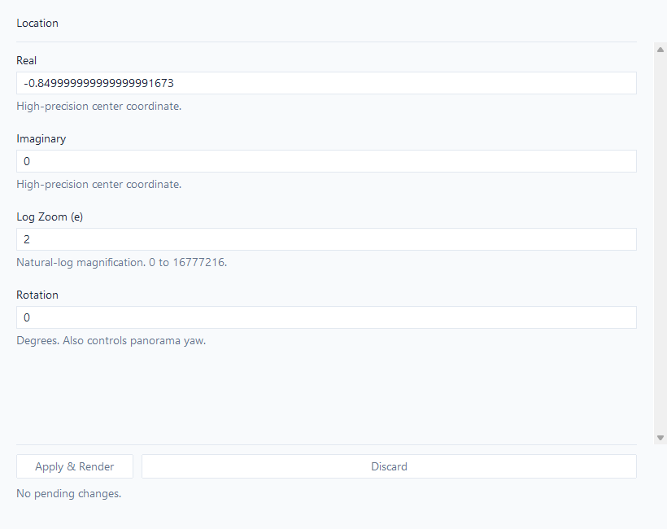
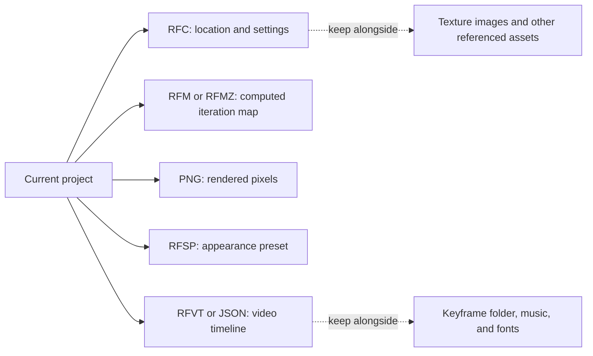
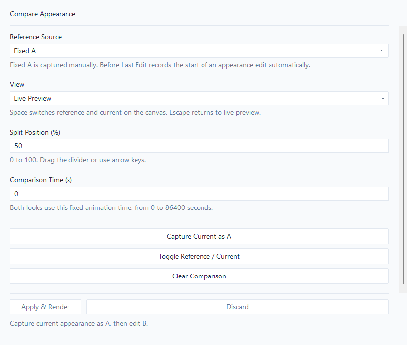

<!-- Created by GPT-6 on 2026-09-24. -->
<!-- Modified by GPT-6 on 2026-09-25, 2026-09-30, 2026-10-01. -->
<!-- Modified by Opus 5.5 on 2026-10-04, 2026-10-25, 2026-10-28, 2026-11-01, 2026-11-07, 2026-11-09, 2026-11-10, 2026-11-11, 2026-11-14. -->
# Workspace and files

[Manual](user-manual.md) · [Actual UI gallery](ui-gallery.md)

## Workspaces, sections, and pending changes

The four main workspaces are **Location & Calculation**, **Surface Effects**, **Animation**, and **Export**. A workspace can contain several modules: for example, appearance has separate Palette, Lighting & Relief, Textures, Patterns, Warp & Stripe, Finishing, Animated Materials, Comparison, and Shader Layers modules.

Choose a section to show its controls. The section list's header button reads **Hide Sections** or **Show Sections** to collapse or restore the list; in the appearance workspace the list is headed **Surface Effects**, like the module chooser above it. Type a value, read the validation message, then choose **Apply & Render**. Until applied, the text is a draft; the picture still uses the last valid applied settings. **Discard** restores the displayed fields to their applied values. Switching sections does not mean that a pending edit has been applied. A marked invalid field must be corrected before that draft can be committed.

The location panel illustrates this arrangement:



**Log Zoom (10)** uses base 10: adding 1 multiplies magnification by 10 at a fixed canvas size. The September 24 capture above retains the older, incorrect “Log Zoom (e)” label; the current workspace and legacy dialog both use the corrected label.

The workspace's history follows applied edits. **Undo** returns to the previous committed state and **Redo** reapplies it. In an active text field, normal text editing shortcuts can take precedence over workspace history. Loading/replacing a document changes the context in which history is valid; save named versions for durable checkpoints.

| Shortcut or control | Use |
| --- | --- |
| Ctrl+F | Focus the settings search. Search an English control name used in this manual. |
| Ctrl+Tab / Ctrl+Shift+Tab | Move forward/backward among the four workspaces. |
| F6 / Shift+F6 | Move focus between workspace regions and the preview. |
| Tab / Shift+Tab | Move among controls in a region. |
| Enter in a form field | Apply the form, unless an open selection list is handling Enter. |
| Ctrl+Z / Ctrl+Y (or Ctrl+Shift+Z) | Undo/redo an applied workspace edit outside text editing. |
| Ctrl+S | Save the current settings document; choose a filename for an unnamed document. |

Search results lead to the relevant setting rather than enabling an effect automatically. If a setting changes nothing, check its master switch, opacity, selected source, and animation mode. [Dependency troubleshooting](SETTINGS_GUIDE.md#when-a-setting-seems-to-do-nothing) explains common cases.

## Surface navigation and shader layers

The Surface editor offers **Basic** and **Detail** views. Basic reduces the number of controls presented; Detail exposes more of the same appearance. Changing the view is not a different rendering algorithm. **All**, **Used**, and **Favorites** filter surface categories. Used reflects contributions from the base style and added effects; a favorite is a workspace preference, not a shader value.

Every other settings page with four or more sections offers the same **All**, **Used**, and **Favorites** above its section list, with a star on each section; a page with fewer sections keeps a plain list. A section that is on shows **On** under its name, and **Used** lists only those: a texture, pattern or animated-material layer that draws, Domain Warp, Stripe, Bloom, Fog, Focus Band, Chaos Blur, Slope Shading, Rim Light, Gloss, Lustre Relief, Band Line, Escape Angle, the orbit Trap, Color Animation, Frozen Colors, HDR & Tone Mapping and GPU Perturbation. A page with none of these, such as Explore, shows only **All** and **Favorites**.

Select a base style first, then adjust its effects. Resetting a group changes artwork values; hiding a group or removing a docked panel does not. The [shader overview](shader-overview.md) explains all 27 Surface groups and alternate names used in the older panels.

Shader Layers controls the enabled compositing order. Moving a layer changes what later layers receive: a color change before bloom can change the light that blooms, while the same change after bloom changes the already-composited image. Disabled custom ordering uses the standard pipeline. See [the order comparison](shader-comparisons.md) and the [29-slot coverage map](shader-coverage.md).

## Panel layout

Use the Panel Layout module to place the main settings panel on the left or right, position navigation independently, and choose whether the section list or settings panel is outside. **Layer Panel Height** changes the space reserved for the layer list. **Side Panel Width** and **Bottom Panel Height** size additional appearance panels.

**Add Appearance Panel** creates another view of the shared settings. Select its content and choose left, right, or bottom placement. **Selected Panel** determines which extra panel the content/position controls edit. **Remove Selected Panel** removes that view, leaving the appearance settings in place. **Restore Panel Layout** restores the arrangement. Resolve pending or invalid edits before replacing panel content. Narrow windows can place extra panels below the preview.

These controls change the working arrangement, not the image resolution. Set the document's canvas dimensions in Export when you want a different output size.

## Save the correct kind of file



Files are saved in **File → Gallery (Save)**. The bar along its bottom saves under the name typed in **Name**, into the folder the window shows:

| Save | What it keeps and how to use it |
| --- | --- |
| **Save Work**, `.rfc` + `.png` (+ `.rfmz`) | The settings and an image side by side under one name, and the map as well while **Also save the map** is on. The simplest choice when unsure. |
| Other Saves → **Settings only**, `.rfc` | The location, calculation, shader and video settings and the document canvas size, to resume work later. Not the computed map or a package of external assets. |
| Other Saves → **Location only**, `.rfl` | The legacy location data: center, log zoom, and iteration limit. Loading it leaves other settings in place; use it to try a location with the current look. |
| Other Saves → **Map only**, `.rfmz` / `.rfm` | Calculated dynamic iteration data, compressed losslessly or uncompressed. Wait until calculation finishes before saving. Use it for recoloring or as a video source. |
| Other Saves → **Image only**, `.png` | Rendered pixels. A PNG does not contain the iteration data needed to redo palette/relief calculations. |
| Other Saves → **Appearance only**, `.rfsp` | Appearance for reuse at another location. Opening it applies the look without using it as a location file. |
| **Save Settings** (File menu, Ctrl+S) | Overwrites the open settings file. For a document never saved, it opens Gallery (Save) with the name field ready. |
| **Timeline Save**, `.rfvt` or `.json` | Timing, tracks, audio references, and zoom-overlay settings, saved from the Timeline Editor. It does not embed keyframe maps, music, texture images, or font files. |

Selecting a card puts its name in **Name**, so saving again replaces that work after asking; files of that name already in the folder are always replaced only after asking. The image of Save Work is written once the view has finished calculating; the map can only be saved then, so Save Work asks whether to save without it while the view is still calculating.

New settings saves use RFC version 8. RFF_Super still reads RFC versions 3 through 7, but earlier releases cannot open version 8, and appearance presets (`.rfsp`) saved by this version are likewise unreadable by earlier releases. Keep a backup before moving files between releases; newer optional fields, including timeline overlays, may not be retained by older readers.

Map files have a separate limit of **200,000,000 internal pixels**, including Clarity, SSAA, and any source padding. A canvas that fits the GPU can still exceed this file limit. Reduce the internal dimensions before saving maps or generating map keyframes.

Saving settings, a location, a map or an appearance also leaves a **thumbnail** beside the file: a small PNG of the view with the same name and the extension `.rfth`. The saved file itself is unchanged, so earlier versions still open it. The Gallery's **Settings** button turns this off (Attach Thumbnails When Saving) and sets the Thumbnail Width to 128, 256 or 512 pixels; **Video → Attach Thumbnails to Keyframes** turns it on for generated keyframes (off by default because a run writes hundreds of files). Keep the `.rfth` beside its file when moving it, or the Gallery has no picture for it.

**New Document** creates a fresh document. When replacing work, use the program's unsaved-change prompt to keep or discard it deliberately. If saving reports a failure, the open edits remain; correct the destination problem and save again.

Files are opened in **File → Gallery (Open)**, from a card; a file in another folder is reached through the folder lists or its drive. Opening does what the extension says: `.rfmz`/`.rfm` puts a map on the canvas, `.png` displays an image, `.rfc` restores settings, `.rfl` moves to a location while keeping the other settings, and `.rfsp` applies an appearance.

Opening an `.rfc` or `.rfl` restores the selected file. After loading an RFC with reference reuse enabled, disable Reuse Reference and recompute if it would otherwise use an orbit belonging to the previous location. If an external texture is missing, select its image again; the affected layer renders nothing until its source is available. A file whose combined resolution/clarity/supersampling exceeds the GPU limit is rejected rather than silently accepting that size.

## Gallery (Open) and Gallery (Save)

**File → Gallery (Open)** and **File → Gallery (Save)** open the same window, which shows the saved files of one folder as thumbnails. Gallery (Open) opens files; Gallery (Save) saves into that folder. Choosing the other entry while the window is open turns it into that one; its title says which it is. Files that share a name — for example `spiral.rfc`, `spiral.rfmz` and `spiral.png` — are one card, which lists what it includes.

To change the folder, click it in one of the two lists on the left. The upper list shows the folders beside the current one (for example `D:\Fractals\Render 1`, `Render 2`, `Render 10` ... while `D:\Fractals\Render 2` is shown, by name with numbers in order), or the drives when a drive itself is shown; the lower list, **Recent Folders**, shows the folders of the files opened or saved most recently. Drag the Recent Folders title up or down to share the space between the two lists. The folders inside the current folder also appear first among the cards; double-click one, or select it and press **Open Folder**, to go into it. The path along the top is also a row of buttons: click a part of it, such as `C:`, to go to that folder. To reach any other folder, click its drive — the first part of the path — and go down through the folder cards. Use the buttons **All**, **Settings**, **Maps**, **Images**, **Appearance** and **Recent Files** to narrow the list, **Newest First** / **By Name** to order it, and **Search by name** to find a file. Recent Files lists the 40 files opened or saved most recently.

Select a card to see its picture and details: what it includes, when it was saved, the file size, and for settings, locations and maps the picture size, zoom and iteration limit.

- **Gallery (Open):** each file of the card has its own **Open** button. A double-click or Enter opens the settings first, then the location, map, image or appearance — or the kind the list is narrowed to. Opening includes the unsaved-changes prompt. The window closes once a file has opened; turn off **Close After Opening** under the **Settings** button to keep it open (the choice is kept). It stays open when the file was not opened, for example when the unsaved-changes prompt was cancelled.
- **Settings** (top right, in both modes) opens a menu: **Close After Opening** (greyed out in Gallery (Save)), **Show File Extensions**, **Attach Thumbnails When Saving** and **Thumbnail Width**. Show File Extensions, off by default, names a card's files by their extensions — `.rfc · .rfmz · .png · .rfth`, for example — instead of by kind, on the card and in the details panel; the choice is kept.
- **Right-click** (in both modes) chooses the card under the pointer and offers **New Folder** and **Rename**. New Folder makes a folder named `New folder` in the folder shown — `New folder (2)` and so on when the name is taken — and puts its name up to be typed over: Enter or clicking elsewhere keeps the typed name, Esc keeps `New folder`. Both are greyed out under Recent Files, and Rename when no card was right-clicked.
- **Rename** (or **F2**) puts the chosen card's name up to be typed over in the same way. A folder takes the new name; a card gives it to all of its files and its thumbnail at once, each keeping its extension, and an extension typed with the name is left off. Nothing is renamed when a file of the new name is already in the folder, or when one of the files is open in another program. Recent Files and Recent Folders follow the new names. Files are only renamed, never deleted.
- **Gallery (Save):** the bar along the bottom saves; see [Save the correct kind of file](#save-the-correct-kind-of-file). Clicking a card chooses it and puts its name in **Name**. A double-click or Enter on a card asks whether to save the current view over its files; **Yes** saves over each kind the card has — settings and image together as Save Work, with the map when the card has a compressed one — and **No** leaves the files as they are. Enter in Name does Save Work. An extension typed with the name, such as `.rfc`, is left off, since each save adds its own; names Windows keeps for devices, such as `CON` or `NUL`, are refused.

| Key | Use |
| --- | --- |
| Arrow keys, Page Up/Down, Home/End | Move the selection. |
| Enter / double-click | Open the selected card (Gallery (Open)), or save over it after asking (Gallery (Save)). A folder card opens the folder in both. |
| Ctrl+F, Tab | Go to the search field; Tab moves on to the cards, and in Gallery (Save) then to Name. |
| Mouse back / forward buttons | Go to the folder shown before or after, as in a web browser. |
| F2 | Rename the selected card or folder. |
| F5 | Read the folder again. The folder is also read again whenever the window is clicked. |

An image shows itself; the small copies made of images are kept in `config/gallery-cache`, which is kept under 256 MB by letting go of the copies looked at longest ago. A settings, location, map or appearance file without a thumbnail — one saved by an earlier version, or a keyframe generated with Attach Thumbnails to Keyframes off — shows **No thumbnail** until it is saved again. No picture is made from a map's numbers alone, because its colors would not be the work's. While a video or keyframe job runs, the window can be looked through but does not open, save or rename files; Rename also waits while an image saved during calculation is still to be written.

## Browse maps and images

Loading an `.rfm`/`.rfmz` opens calculated map data; loading a `.png` displays an image. These are different inputs: an image already has colors, whereas a dynamic map can be reshaded from iteration values. Loading an image does not reconstruct its original Mandelbrot coordinates.

While browsing a folder, **Left/Right** moves to the previous/next item, **Up/Down** takes larger steps, and **Home/End** goes to the first/last item. For maps, type a one-based item number and press Enter to jump; Backspace edits the number and Escape cancels the typed jump. Escape exits image browsing. A long calculation/generation/export can reserve the data and temporarily prevent browsing.

## Compare appearances fairly



1. Set the desired location and wait for the calculation.
2. Choose **Capture Current as A** to retain a fixed appearance reference.
3. Change the appearance and apply it.
4. Select **Split Reference / Current**, or toggle Reference/Current.
5. Set **Comparison Time (s)** to the same animation time for both looks. Move **Split Position** to inspect fine detail.

**Reference Source** chooses fixed A or the appearance before the last tracked edit. Fixed A survives a sequence of appearance edits; Before Last Edit is useful for one-step adjustments. Both comparisons use the current view, so this is an appearance comparison rather than a stored picture of an unrelated location. **Live Preview** returns to ordinary animation. **Clear Comparison** removes the stored comparison state. In the comparison view, Space toggles the two versions and Escape returns to live preview.

For a reproducible comparison, retain the RFC files and use a fixed time, canvas size, sampling, and source map. A moving palette can otherwise look different even when the setting under investigation did nothing.

## Language, theme, and legacy panels

**View → Language / 言語** selects English or Japanese; restart is required. **Show Setting Descriptions** shows explanatory text under controls. **Dark Mode** changes the interface colors. **Use Legacy Settings UI** makes relevant menu entries open the older settings windows instead of the corresponding workspace sections. The old and new interfaces edit the same application settings, although labels and control arrangement differ.

## Menu visibility and optional AI entry points

`menu-visibility.json` controls which menu entries appear. It lives in the `config/` folder beside the executable's folder: with `bin/RFF_Super.exe`, this is `config/menu-visibility.json`. A copy left at the application root by an older build is moved there on startup. On first startup, the application writes a template if the file is absent and the directory is writable. Edit it while RFF_Super is closed, then restart.

The file controls the main menu bar and the Timeline Editor's **AI Edit** button. The timeline's right-click **Parameters** menu, including **Zoom Overlay** and **Max Iterations Display**, is not controlled by this file; adding those keys has no effect. Existing files are not automatically expanded when new menu entries are introduced. To control the guide entry, add `"Open Guide": true` or `false` inside the `"Help"` object. A file written before 3.2.1.1 that hides the menu or its items under `"?"` still hides them.

Keys use the original English captions even in the Japanese interface. Set an item to `false` to hide it, or `true` to show it; setting a whole menu to `false` hides its submenu. Missing ordinary entries default to visible. **Local AI appearance** and the timeline's **AI Edit** button default to hidden and need explicit enabling:

```json
{
  "Shader": { "Local AI appearance": true },
  "Timeline Editor": { "AI Edit": true }
}
```

Merge these entries into an existing file if you want to retain its other visibility choices. This changes access points, not the saved artwork or model connection. If either AI entry is missing, check this file before troubleshooting the server. See [Local AI setup](local-ai.md) and [Timeline AI Edit](animation-and-export.md#timeline-ai-edit).

Source basis: [Application](../src/rff2/ui/Application.cpp), [File commands](../src/rff2/ui/CallbackFile.cpp), [Gallery](../src/rff2/ui/GalleryWindow.cpp), [thumbnails](../src/rff2/io/ThumbnailIO.cpp), [WorkspaceShell](../src/rff2/ui/workspace/WorkspaceShell.hpp), [ComparisonWorkspace](../src/rff2/ui/workspace/ComparisonWorkspace.cpp), and [menu visibility](../src/rff2/io/MenuVisibilityIO.hpp).
